# SwimmingPool
游泳馆系统
亮点：WebSocket实时聊天、Echarts图形化分析、课程与场地双预约、预约容量校验、支付超时释放名额、课时跟踪、取消规则与退款金额计算；
角色：用户、教练、管理员；

# 游泳馆预约系统

> B/S 前后端分离 · 用户前台 + 教练端 + 管理后台 · 三角色权限管理
>
> Spring Boot 3.3.1 + Vue 3 + Vite + Element Plus + MyBatis-Plus + MySQL + JWT + WebSocket + ECharts

一套游泳馆的线上预约系统，把「上游泳课」和「来游泳」两件事放在同一个入口里：用户浏览课程和场地、选时段下单、模拟支付、看课时进度；教练维护自己的课程、确认上课记录、跟学员在线沟通；管理员排场地时段、审教练资料、看课程与场地的运营数据。课程名额和场地时段各自校验，超过 5 分钟没付款的预约会被定时任务收回名额。

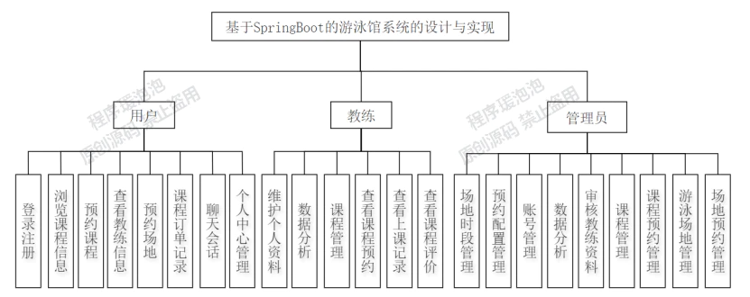

上图是系统的功能结构：用户侧从登录注册、浏览课程、预约课程一路到课程订单、聊天会话与个人中心；教练侧是维护个人资料、课程管理、查看课程预约、上课记录与课程评价；管理员侧是场地时段管理、预约配置、账号管理、审核教练资料、课程管理、课程预约管理、游泳场地管理与场地预约管理。

---

## 一、技术栈

| 层次 | 选型 |
| :--- | :--- |
| 架构 | B/S、MVC、前后端分离、用户前台 + 教练端 + 管理后台、多角色权限管理 |
| 运行环境 | Windows |
| 开发环境 | IDEA、JDK 17、Maven、MySQL、Node.js |
| 后端 | Java、Spring Boot 3.3.1、Spring MVC、MyBatis-Plus、MySQL、JWT、WebSocket、Spring 定时任务、Apache POI |
| 前端 | Vue 3、Vite、Element Plus、Vue Router、Pinia、Axios、ECharts、SCSS |

## 二、角色与功能范围

| 角色 | 主要使用范围 |
| :--- | :--- |
| 用户 | 注册与登录；课程中心（按时间、教练筛选，查看课程详情）；预约课程与取消预约、课程订单记录；课程评价；场地中心（按日期、场地类型筛选）；场地预约与限时取消、场地预约记录；我的上课（课时进度、预约上课）；个人中心（资料、密码）；消息（与教练会话） |
| 教练 | 个人资料维护与提交审核；课程管理（新增、修改、删除自己的课程）；课程预约（查看学员预约、取消预约）；上课记录（确认、完成、取消）；课程评价查看；个人数据分析（授课统计、学员评价、授课收入）；消息中心 |
| 管理员 | 账号管理与教练资料审核；游泳场地管理；场地时段排班；课程管理与课程类型；课程预约管理；上课记录；场地预约管理；预约配置（取消时限）；教练课程可视化、场地分析 |

## 三、功能亮点

- **课程与场地双预约**：课程报名走「选课 → 提交 → 模拟支付 → 订单记录 → 取消」一条线，场地预约走「选场地 → 选日期 → 选时段 → 确认预约」另一条线。两条线各自有列表、额度和取消规则，培训与日常游泳不会混在一起。
- **预约容量校验**：提交时先看课程名额有没有满、场地是否开放、该时段还有几位，再校验同一用户是否重复预约；预约与取消都会重新统计已约人数，满了就把课程状态从「可预约」切走。
- **支付超时释放名额**：定时任务每分钟扫一遍，把超过 5 分钟仍未支付的课程与场地预约自动取消，占用人数重算，名额退回池子。
- **课时跟踪**：课程预约记录总课时与已用课时，配合上课记录的确认、完成、违约与取消，学员端看到的是「剩余 9 节 / 共 10 节」这样的一行，教练端看到的是每一节的节次与状态。
- **取消规则与退款金额计算**：取消时限按业务配置；取消课程预约时按未使用课时占比算退款金额并保留两位小数，方便核对剩余课时值多少钱。
- **WebSocket 实时沟通**：会话列表、历史消息、未读数与已读处理，学员和教练聊课程安排不用跳出系统。
- **ECharts 多维分析**：管理端的教练课程分析（收入玫瑰图、课程类型分布、预约状态、学员数排行）、场地分析（收入占比、月度趋势），教练端的个人分析（预约状态、上课状态、月度收入），都做成了图表。

---

## 四、界面展示

> 说明：源文档首图是三端功能结构图（并非登录页），已放在文首作为系统总览，本文不设「登录入口」分区。用户端为 1.6–1.9 比例的整页截图，教练端与管理端为 2.1–3.4 比例的宽屏后台，一律全宽单图排布，避免表格文字被压糊。

### 4.1 用户端

顶栏是「畅游游泳馆」，菜单七项：首页、课程中心、教练团队、场地中心、我的上课、个人中心、消息，右上角是当前登录人王小明与「用户」身份标。

#### 4.1.1 首页

四张快捷卡分别是课程预约、场地预约、我的预约、个人中心。往下是「热门课程」四门：自由泳零基础入门班 ¥299（张教练 · 自由泳入门 · 03-26 09:00 · 2/10 人）、蝶泳技术提升班 ¥399（张教练 · 蝶泳进阶 · 03-27 14:00 · 0/8 人）、蛙泳基础教学班 ¥259（原价 ¥298，李教练 · 蛙泳入门 · 03-28 09:00 · 0/12 人）、少儿趣味游泳班 ¥199（李教练 · 少儿游泳 · 03-29 10:00 · 0/8 人）。卡角带「可预约」标，底部是「热门场地」四个泳池入口。

卡上的「已约/总名额」就是容量校验的展示位：2/10 说明这门课还剩 8 个位子，0/8 说明还能报 8 人。

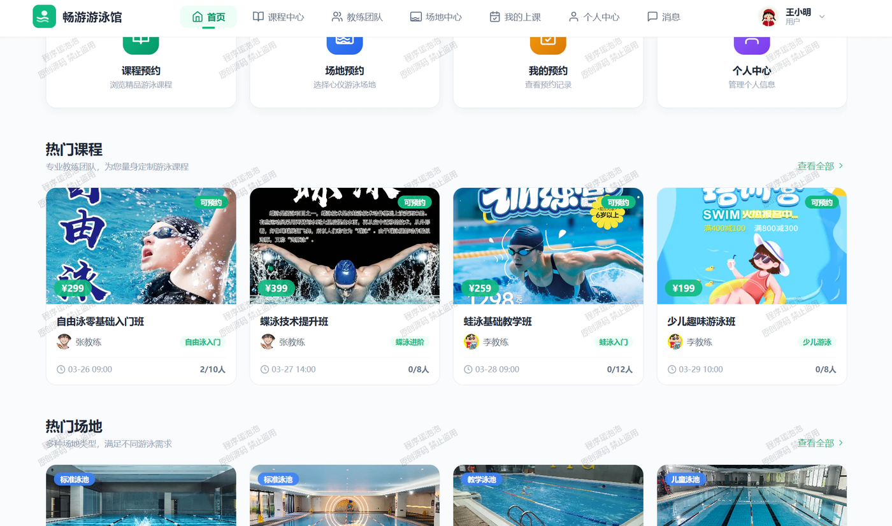

#### 4.1.2 课程详情

课程详情页左侧是课程大图与基本信息：课程名「自由泳零基础入门班」，标签「自由泳入门」「C区教学泳池」，价格 ¥299，上课时间 2026-03-26 09:00:00 ~ 11:00，上课地点 C区教学泳池，预约人数 2/10 人，课程状态「可预约」；下方接课程介绍与授课教练。

右侧卡片是下单区：¥299，下面一行「剩余 8 个名额」——10 减 2 算出来的，和左侧预约人数对得上；「立即预约」按钮下面三条规则写得很具体：提交后需在 5 分钟内完成支付、开课前 144 小时可免费取消、课程结束后可提交评价。第一条对应定时任务释放名额，第二条对应取消时限配置。

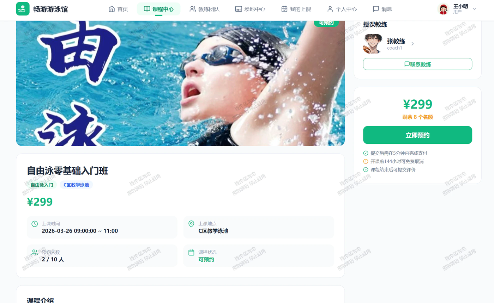

#### 4.1.3 教练团队

教练档案页：李教练，擅长蛙泳、仰泳，执教 5 年，三个数字分别是课程数 2、评价数 0、平均评分「-」（还没有人评过），下面是教练介绍、资质认证与证书编号 CERT20260002，右上「联系教练」直接进会话。

下方标签页「教练课程 2」「学员评价」，两门课都在这里：蛙泳基础教学班 ¥259（蛙泳入门 · C区教学泳池 · 03-28 09:00 · 0/12 人）、少儿趣味游泳班 ¥199（少儿游泳 · D区儿童泳池 · 03-29 10:00 · 0/8 人）。课程数 2 与列表两条一致，评价数 0 与平均评分空着也一致。

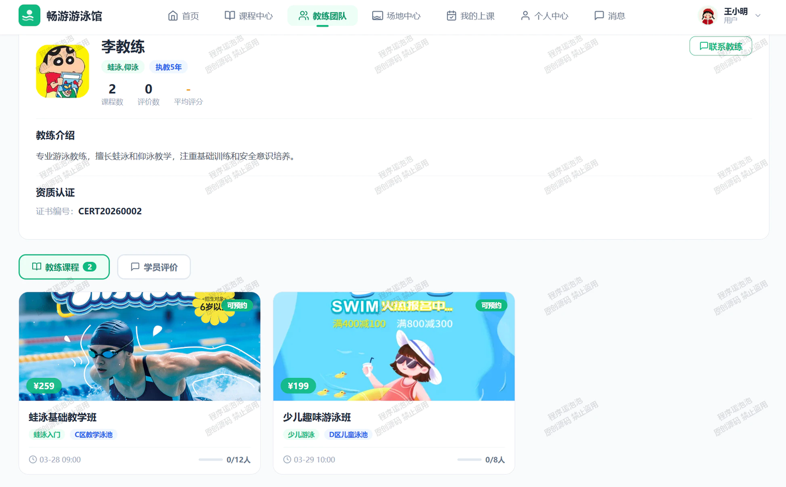

#### 4.1.4 场地中心

场地列表，右上角显示「共 4 个场地」，每张卡带场地类型标签与「开放中」状态：A区标准泳池（容纳 30 人 · 游泳馆一楼东侧 · ¥50/时段）、B区标准泳池（25 人 · 一楼西侧 · ¥50/时段）、C区教学泳池（20 人 · 二楼北侧 · ¥40/时段）、D区儿童泳池。顶部可按场地名称（搜索框）、类型、状态三个条件筛选。

四张卡的容量 30 / 25 / 20 / 15，加起来正好是管理端场地分析里「总容纳人数 90」这个数。

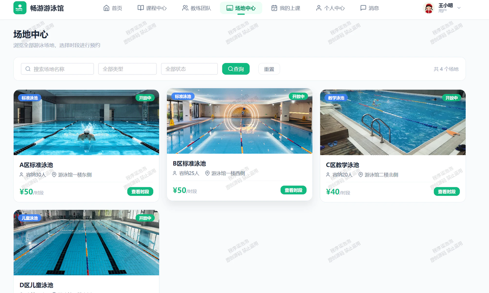

#### 4.1.5 场地预约

从场地卡进到具体场地：A区标准泳池，容纳人数 30 人，开放时间 2026-03-24 06:00 ~ 22:00，位置游泳馆一楼东侧，基础价格 ¥50/时段。下面是日期条（今天 25、周四 26、周五 27、周六 28、周日 29、周一 30、周二 31）与时段卡，当前选中的时段是 18:03-19:03、价格 ¥1、余 9 位。

右侧确认栏回填时段、费用 ¥1、预约人姓名王小明与脱敏手机号，下方三条规则：提交后需在 5 分钟内完成支付、开始前 12 小时可免费取消、可提前 7 天预约。这里的 ¥1 是管理端给这个时段单独定的价，基础价格那一行仍写着 ¥50/时段，说明场地有一个基准价，具体时段可以另定价。

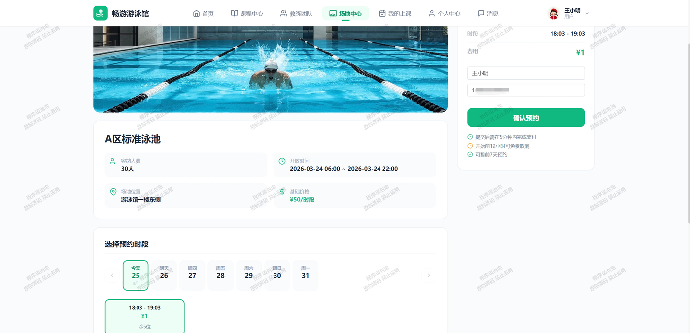

#### 4.1.6 我的上课

「我的上课」是课时页：顶部筛选条件与「共 1 条记录」，第一条是第 1 节 · 自由泳零基础入门班 · 张教练 · 2026-03-25，状态「已完成」。点「+ 预约课程」弹出预约框，可选课程两门，每门后面直接带课时余额：蝶泳技术提升班「剩余 10 节 / 共 10 节」、自由泳零基础入门班「剩余 9 节 / 共 10 节」——上了第 1 节，所以 10 扣 1 剩 9。下面填上课时间（日期选择器到 2026 年 8 月）与选填备注。

课时不是抽象的数字，是跟「第几节 + 状态」一起记的：这一节完成后余额减一，教练端把该节标成「已完成」，学员端这里就少一节。

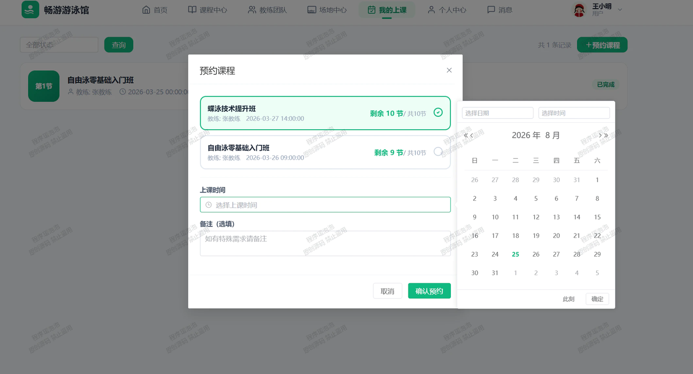

#### 4.1.7 课程订单记录

个人中心左侧是六个入口：个人资料、修改密码、课程订单记录、课程评价、场地预约记录、我的上课。资料卡显示王小明 / user1 / 13800000004 / user1@swimming.com。

订单记录「共 5 条」，截图里能看到三条：蝶泳技术提升班 ¥399（张教练 · 2026-03-27 14:00 · 已预约 · 订单号 CB1787647664987）、自由泳零基础入门班 ¥299（已预约 · CB177429485339）、自由泳零基础入门班 ¥299（已取消 · CB1774425897015）。已预约的两条带「取消预约」按钮，已取消的那条没有——状态决定操作，取消过的订单不再给退款入口。

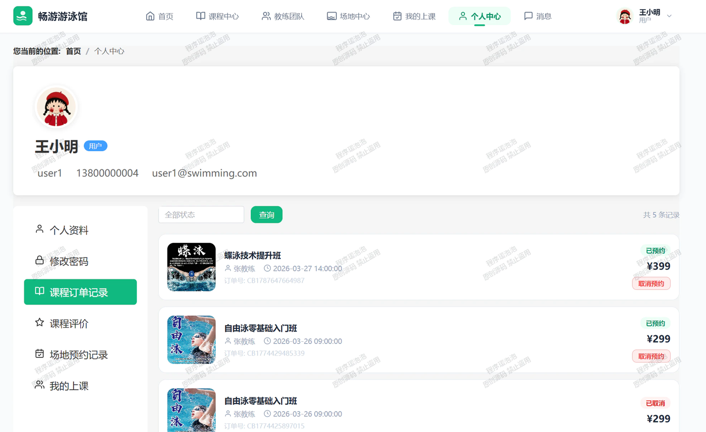

### 4.2 教练端

后台是「游泳馆管理」，左侧菜单：我的资料、数据分析、课程管理、课程预约、上课记录、课程评价，底部消息中心与退出登录，右上角是当前账号 coach1 与「教练」身份。

#### 4.2.1 数据分析

八个指标卡里的六个：课程总数 2、预约总数 6、总收入 ¥997、平均评分 5、评价总数 1、上课总节数 2。左侧环形图是课程预约状态分布（已预约 5、已取消 1，合计 6 与预约总数一致），右侧环形图是上课记录状态统计（已完成 1、待确认 1，合计 2 与上课总节数一致），下方是月度收入趋势折线。

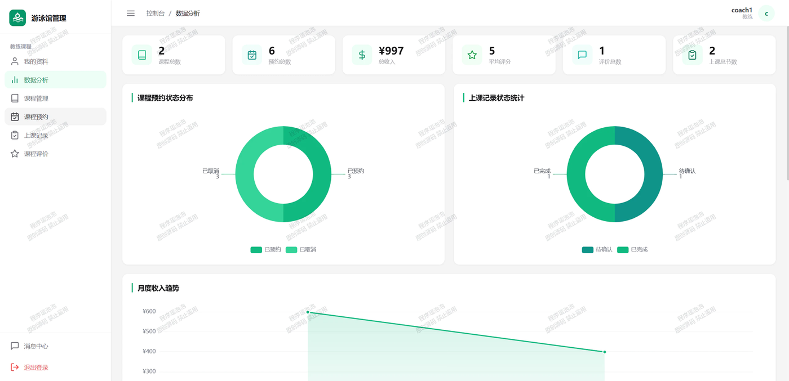

#### 4.2.2 课程管理

「课程列表 共 2 条记录」，列是课程名称、封面图、课程类型、场地、金额、人数、总节数、开始时间、课程状态、操作。自由泳零基础入门班（自由泳入门 · C区教学泳池 · ¥299 · 2/10 · 10 节 · 2026-03-26 09:00 · 可预约）、蝶泳技术提升班（蝶泳进阶 · A区标准泳池 · ¥399 · 1/8 · 10 节 · 2026-03-27 14:00 · 可预约）。

这里的「人数」列就是已约/总名额，和用户端课程详情、首页卡片是同一组数。右上「+ 新增课程」与「批量删除」，行内是修改与删除。

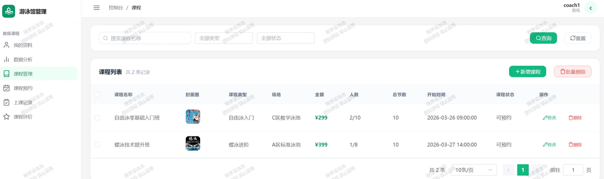

#### 4.2.3 课程预约

「课程预约列表 共 6 条记录」，列是订单号、用户、课程名称、教练、金额、课时、退款金额、开始时间、预约状态、支付状态、操作。六条按时间倒序：CB1787647664987 王小明 蝶泳技术提升班 ¥399（0/10 节 · 已预约 · 已支付）、CB177429485339 王小明 自由泳 ¥299（1/10 节 · 已预约）、CB1774425897015 王小明 自由泳 ¥299（0/10 节 · 已取消）、CB20260324003 王小明 蝶泳 ¥399（0/1 节 · 已取消）、CB20260324002 赵小红 自由泳 ¥299（0/1 节 · 已预约）、CB20260324001 王小明 自由泳 ¥299（0/1 节 · 已取消）。

「课时」列写成「已用 / 总」，跟用户端「剩余 9 节 / 共 10 节」是同一份数据的两面；「退款金额」列六条都是「-」，说明这批取消没有产生退款金额（取消时已过免费取消时限之外的场景才会算钱）。行内「取消」只出现在仍为「已预约」的三条上。

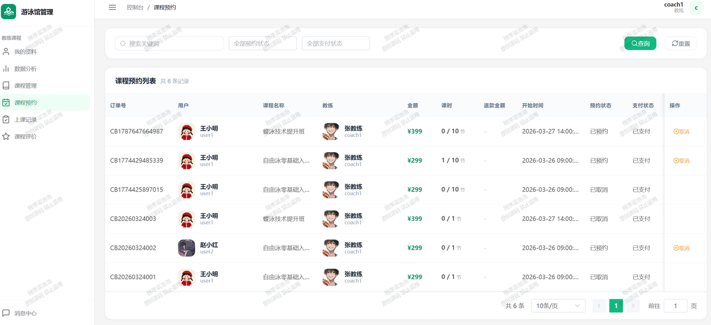

#### 4.2.4 上课记录

「教练上课记录 共 2 条记录」，列是课程名称、教练、学员、第几节、上课时间、状态、操作。蝶泳技术提升班 · 王小明 · 第 1 节 · 2026-08-12 00:00:00 · 待确认，行内「确认」「取消」；自由泳零基础入门班 · 王小明 · 第 1 节 · 2026-03-25 00:00:00 · 已完成，没有操作。

两条记录正好是数据分析页「已完成 1、待确认 1」的明细，学员端「第 1 节 已完成」也是这一行的另一侧。

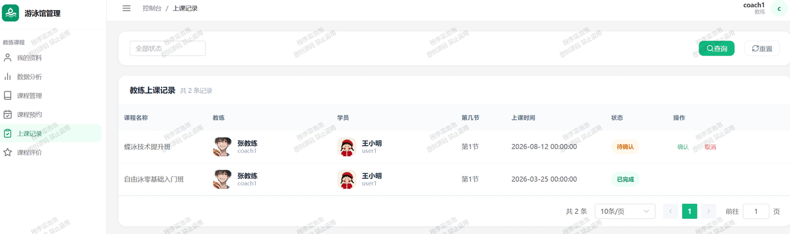

#### 4.2.5 消息中心

左边会话列表，每条带头像、姓名、最后一条消息与时间，右边是会话窗口，气泡按时间排（17:04 一条、17:16 一条），底部输入框与发送按钮。未读会话在列表上有红点计数，点开即已读，这是 WebSocket 那套未读数与已读回执的落地位置。

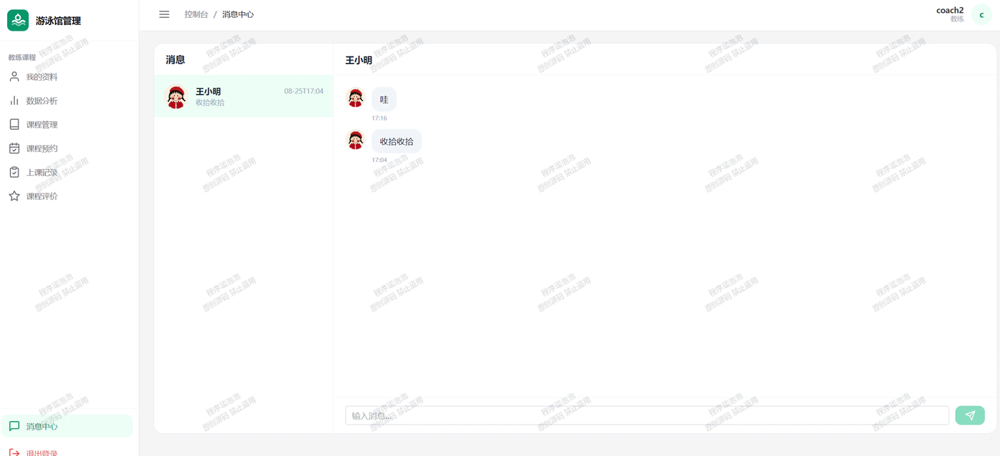

### 4.3 管理员端

左侧菜单分四组：系统管理（账号管理）、教练管理（教练资料、教练课程分析、课程管理、课程预约、上课记录、课程评价、课程类型）、场地管理（游泳场地、场地预约、场地时段、场地类型）、数据分析（场地分析），底部消息中心。

#### 4.3.1 教练课程可视化

八个指标卡：教练总数 2、课程总数 4、预约总数 6、总收入 ¥997、平均评分 5 分、评价总数 1、上课总节数 1、上课完成率 100%。下面两块图：教练收入玫瑰图（张教练 ¥997，正好等于总收入，说明当期只有一位教练的课程产生了收入）、课程类型分布环形图（自由泳入门、蛙泳入门、蝶泳进阶、少儿游泳各 1，合计 4 与课程总数一致）。再往下是预约状态分布与教练学员数排行。

课程总数 4 也是全平台口径：张教练两门（自由泳 ¥299、蝶泳 ¥399）+ 李教练两门（蛙泳 ¥259、少儿 ¥199），和用户端教练团队的课程数 2 对得上。上课总节数这里是 1、完成率 100%，因为管理端口径只算已完成的那节；教练端口径是 2（含待确认），两个数字都不错，只是统计范围不同。

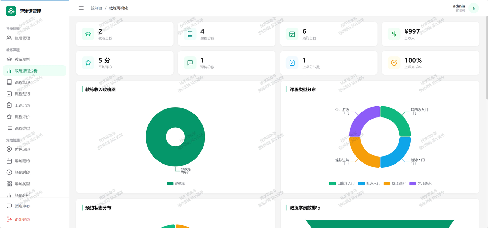

#### 4.3.2 上课记录

「教练上课记录 共 1 条记录」：自由泳零基础入门班 · 张教练 · 王小明 · 第 1 节 · 2026-03-25 00:00:00 · 已完成。与教练端相比少了那条「待确认」的蝶泳记录——待教练确认的记录还没进这一层统计。

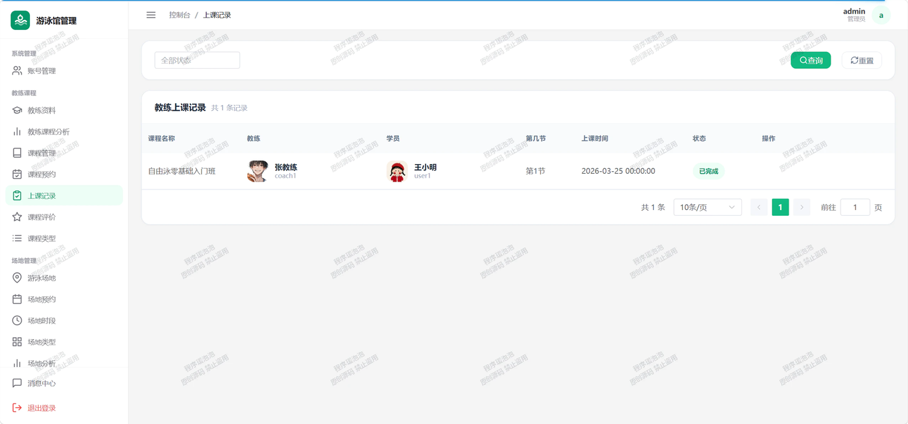

#### 4.3.3 游泳场地

「游泳场地列表 共 4 条记录」，列是场地名称、场地图片、场地类型、场地编号、基础金额、容纳人数、场地状态、操作：A区标准泳池（POOL-A01 · 标准泳池 · ¥50 · 30 · 开放中）、B区标准泳池（POOL-B01 · ¥50 · 25）、C区教学泳池（POOL-C01 · 教学泳池 · ¥40 · 20）、D区儿童泳池（POOL-D01 · 儿童泳池 · ¥30 · 15）。

场地编号把「类型 + 序号」编进了编码里，价格与容量按池型递增递减：标准池 50 元 / 30 人、教学池 40 元 / 20 人、儿童池 30 元 / 15 人。右上「+ 添加场地」「批量删除」。

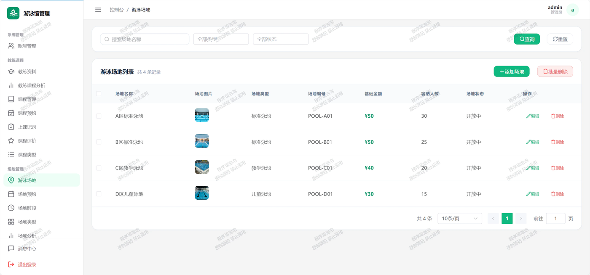

#### 4.3.4 场地时段

排班页：左侧选场地（A区 / B区 / C区 / D区），右侧是按周排的时段表，表头 08-24 ~ 08-30 一周七天，右上「上一周 / 下一周 / 今天」，当前停在「今天」08-25 周二。每格都有「+ 添加时段」，周二那格已排一个时段卡：18:03 - 19:03、¥1、0/5 已预约，卡上有编辑与删除。

这个 18:03-19:03 / ¥1 / 0/5 就是用户端场地预约页选中的那个时段——时段由管理员在这里排，用户端才看得见、才能下单，余位 0/5 也会同步成「余 4 位」这样的提示。

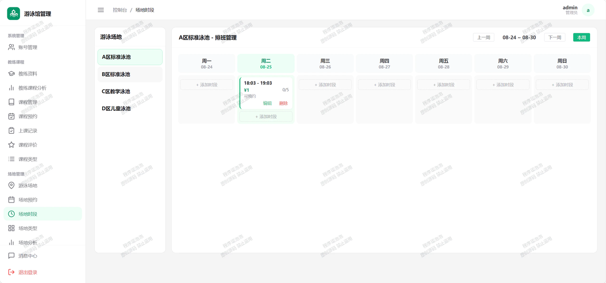

#### 4.3.5 场地分析

八个指标卡：场地总数 4、开放场地 4、预约总数 5、总收入 ¥200、总容纳人数 90、已使用预约 0、取消/退款 1、使用率 0%。两块主图：预约状态分布（已预约 4、已取消 1，合计 5 与预约总数一致）、场地类型收入占比（标准泳池 ¥160、教学泳池 ¥40，合计 ¥200 与总收入一致）。下方是月度预约与收入趋势双轴图。

三个数字互相咬得住：容量 30+25+20+15 = 90；收入 160+40 = 200；预约 4+1 = 5。已使用预约 0、使用率 0%，对应的是五笔场地预约都还停在「已预约」，没有核销成「已使用」。

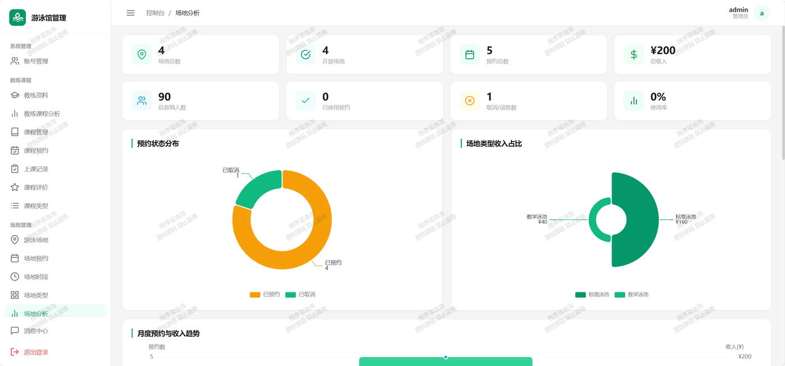

---

## 五、几个实现要点

**1. 课程与场地为什么分两套预约**
课程是按「门」卖的，一门课有总课时（10 节），报一次名占一个名额，后面按节上课；场地是按「时段」卖的，一个时段是一个可售单元，价格挂在时段上而不是场地上。两者共用一套支付与取消流程，但容量、课时与退款口径完全不同，所以数据结构与页面都拆开。

**2. 容量校验的四个判据**
提交预约时要过四道：课程名额是否已满（已约人数 ≥ 总名额）、场地是否处于开放状态、所选时段是否还有余位、同一用户是否已约过这个课程/时段。任何一道不过就拦住，通过后已约人数 +1，满了把课程状态切离「可预约」。

**3. 名额怎么被收回**
课程详情页那条「提交后需在 5 分钟内完成支付」不是文案，是定时任务的条件：每分钟扫一次，未支付且创建超过 5 分钟的预约直接置为取消，已约人数重算，名额回到可预约池。用户主动取消走的是另一条路径（按场地的 12 小时 / 课程的 144 小时时限判断是否可免费取消）。

**4. 课时怎么跟上课记录咬合**
课程预约上有总课时与已用课时两个字段，上课记录按「第几节」一条条长出来。教练确认一次、完成一次，已用课时 +1，学员端「剩余 X 节 / 共 10 节」随之变化；违约与取消走另外两条分支，不扣课时但留痕。

**5. 退款金额怎么算**
取消课程预约时按未使用课时占比算：退款 = 实付金额 ×（剩余课时 / 总课时），结果保留两位小数。这样退的是「还没上的那几节」的钱，而不是简单按比例退全款。

**6. 消息的未读与已读**
会话列表按最后一条消息时间排序，每个会话带未读数；点进会话即发已读回执，红点清掉。消息通过 WebSocket 推送，发送方不用刷新页面就能看到对方回的消息。

**7. 三个视角的图表分工**
管理端看全局（教练收入构成、课程类型分布、场地收入占比、月度趋势），教练端看自己（我的预约状态、我的上课状态、我的月度收入），用户端不看图只看列表。同一个「预约」在不同角色下有不同聚合粒度，这也是为什么管理端与教练端的上课节数会不一样。

---

## 六、说明

> 文档展示 18 张截图，需要了解更多，请联系我。
